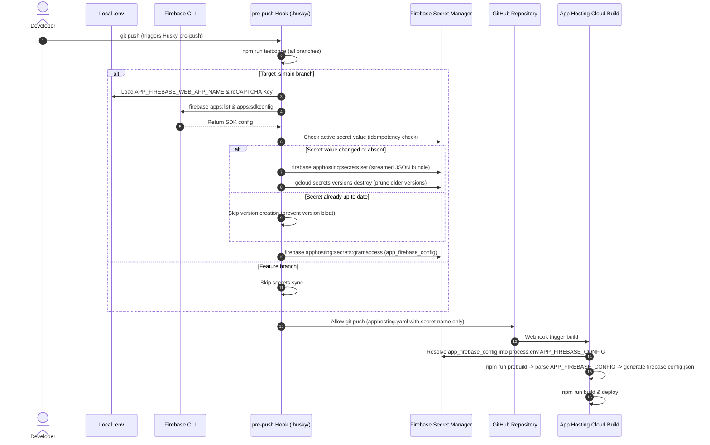

# 0007: Firebase App Hosting Secret Management and Zero-Credential Git Strategy

- **Status**: Accepted
- **Date**: 2026-09-04 (Updated 2026-09-12, Updated 2026-10-17: Consolidated Single-Secret Architecture & Cost Dynamics)

## Context

When deploying applications using **Firebase App Hosting** with continuous GitHub integration, build containers dynamically compile frontend runtime assets (specifically `public/firebase.config.json`) during the `prebuild` phase. This compilation requires active Firebase credentials (API Key, Project ID, App ID, Storage Bucket, Messaging Sender ID, Auth Domain) and the reCAPTCHA Enterprise Site Key.

However, handling these credentials presents three distinct challenges:

1. **Repository Security & Scanner Alerts**: Committing raw Google API keys (`AIzaSy...`) or reCAPTCHA credentials directly into `apphosting.yaml` or tracked Git files triggers automated GitHub secret scanning alerts, fails enterprise compliance audits, and exposes project identifiers to public scrapers.
2. **Cloud Infrastructure Overhead**: Navigating the Google Cloud Platform (GCP) Console to manually create secrets in Secret Manager, configure replication policies, and assign `Secret Manager Secret Accessor` IAM permissions to Cloud Build and App Hosting service accounts is complex, error-prone, and slow.
3. **Web Console Friction & Configuration Redundancy**: Manually copying and pasting separate SDK environment variables into local `.env` files and the Firebase Web Console creates configuration drift and increases the risk of human error.

## Decision

We implement a **Zero-Credential Git Strategy** combined with **Automated CLI Web App Discovery & Secret Provisioning**, **Idempotent Single-Secret Consolidation**, and a **Git `pre-push` gatekeeper hook** to securely bridge local configuration to Firebase App Hosting:

### 1. Declarative Secret Reference in `apphosting.yaml`

`apphosting.yaml` declares variable-to-secret _name references_, containing zero literal keys, credentials, or sensitive strings. Variable names use the `APP_FIREBASE_*` prefix to comply with Firebase App Hosting schema restrictions that reserve system prefixes (`FIREBASE_`, `X_GOOGLE_`, `EXT_`, `KIT_`).

Rather than provisioning discrete secrets per environment variable (which rapidly consumes Google Secret Manager quotas), we consolidate the frontend runtime configuration into a single secret reference:

```yaml
runConfig:
  minInstances: 0
  maxInstances: 2 # Prevents Google Cloud from scaling up infinitely during an attack

env:
  - variable: APP_FIREBASE_CONFIG
    secret: app_firebase_config
```

### 2. Streamlined Local `.env` & Dynamic CLI SDK Discovery

Developers only maintain the Web App display name (`APP_FIREBASE_WEB_APP_NAME`), `APP_FIREBASE_RECAPTCHA_ENTERPRISE_KEY`, and optional `APP_FIREBASE_APPCHECK_DEBUG_TOKEN` in `firebase/.env`.

Both local config generation and cloud secret provisioning dynamically query the Firebase CLI:

- Run `firebase apps:list WEB --json --project default` to find the target web app's `appId` by display name.
- Run `firebase apps:sdkconfig WEB <appId> --json --project default` to fetch the authoritative SDK properties directly from Google Cloud.

### 3. Fail-Fast Local Environment Validation

To prevent corrupt or empty strings from being provisioned or compiled, automation scripts validate required environment variables upfront. If any variable is missing, blank, or contains placeholder characters (e.g., `<...>`):

- The process immediately logs a descriptive error identifying the exact issue.
- Execution halts instantly with exit code `1`, preventing accidental deployment or broken builds.

### 4. Consolidated CLI Secret Provisioning (`firebase/scripts/deploy-apphosting-secrets.mjs`)

A dedicated Node.js automation script (`npm run config:secrets`) handles cloud provisioning directly from the developer's terminal:

- **Single Source of Truth (`apphosting.yaml`)**: Dynamically parses the `env:` declarations in `apphosting.yaml` (extracting `APP_FIREBASE_CONFIG` $\rightarrow$ `app_firebase_config`) instead of maintaining hardcoded secret mappings in script code.
- **Unified JSON Secret Bundle**: Bundles the authoritative Firebase SDK properties (`apiKey`, `authDomain`, `projectId`, `storageBucket`, `messagingSenderId`, `appId`) together with `APP_FIREBASE_RECAPTCHA_ENTERPRISE_KEY` into a single consolidated JSON payload:
  ```json
  {
    "app": {
      "apiKey": "...",
      "authDomain": "...",
      "projectId": "...",
      "storageBucket": "...",
      "messagingSenderId": "...",
      "appId": "..."
    },
    "recaptchaEnterpriseKey": "..."
  }
  ```
- **Idempotency Verification**: Queries the current cloud secret value via `npx firebase apphosting:secrets:access app_firebase_config`. If the active cloud value matches the local payload, creating a new secret version is skipped entirely, preventing version churn.
- **Transient Error Retries**: Implements automatic retry handling for transient HTTP 503 Service Unavailable responses from Secret Manager endpoints.
- **Single-Version Retention Invariant**: When an update is necessary, older active versions are enumerated via `gcloud secrets versions list` and pruned via `gcloud secrets versions destroy <versionId> --secret <secretName> --quiet`, ensuring $\le 1$ active version remains.
- **Dynamic Backend ID Resolution**: Resolves the target backend ID dynamically from CLI arguments (`--backend <name>`), `APP_FIREBASE_BACKEND_ID` in `.env`, or defaulting to the project's `package.json` `name`.
- Streams secret values securely into Firebase Cloud via `npx firebase apphosting:secrets:set <secretName> --data-file - --force` without interactive prompts.
- Grants read permissions to the backend compute service account via `npx firebase apphosting:secrets:grantaccess <secretName> -b <backendId>`.

### 5. Git `pre-push` Gatekeeper Hook (`.husky/pre-push`)

To completely eliminate human error (forgetting to sync changed keys) without slowing down routine development on feature branches, we use a Git `pre-push` Husky hook:

- Every time `git push` is executed, Husky runs `npm run test:once` on all branches first to prevent pushing failing code.
- The hook inspects the destination ref via `stdin`: only pushes targeting the **`main` branch** trigger `npm run config:secrets` to synchronize secrets to Firebase App Hosting. Pushes to feature branches skip secret synchronization.
- If the local keys are valid and successfully synced to the cloud safe, the git push is allowed to proceed to GitHub.
- If there is a typo or missing value when pushing to `main`, the hook aborts the git push instantly, protecting the production build pipeline from running with broken or empty secrets.

### 6. Build-Time Container Injection & Dual-Mode Config Generation (`firebase/scripts/generate-firebase-config.mjs`)

Frontend assets (`public/firebase.config.json`) are compiled dynamically via `npm run prebuild`:

- **Cloud Build (App Hosting)**: App Hosting resolves secret `app_firebase_config` and injects its stringified JSON payload into `process.env.APP_FIREBASE_CONFIG`. Because `.env` is gitignored and absent in CI/CD containers, `generate-firebase-config.mjs` detects the absence of `.env`, parses `process.env.APP_FIREBASE_CONFIG`, validates required SDK properties, and outputs `public/firebase.config.json`.
- **Local Development**: When `firebase/.env` is present, `generate-firebase-config.mjs` preserves the seamless local developer workflow: it loads `.env`, resolves SDK parameters dynamically using the Firebase CLI (`apps:sdkconfig`), and writes `public/firebase.config.json` without requiring cloud secrets access.



## Incident Postmortem: Secret Manager Pricing Trap & Version Bloat

### 1. Incident Summary & Root Cause

During continuous delivery iterations on the project, the repository pre-push hook synchronized credentials on every push to the `main` branch. The legacy architecture maintained 7 discrete secrets:

1. `firebase_api_key`
2. `firebase_auth_domain`
3. `firebase_project_id`
4. `firebase_storage_bucket`
5. `firebase_messaging_sender_id`
6. `firebase_app_id`
7. `firebase_recaptcha_enterprise_key`

Each invocation of `firebase apphosting:secrets:set` creates a new, immutable version in Google Secret Manager without overwriting prior versions. Because there was no idempotency check and no lifecycle pruning of superseded versions, the project accumulated **684 active secret versions**, generating unintended Google Cloud billing charges of approximately **$41 USD/month (~HKD 10.70/day)**.

### 2. Secret Manager Pricing Mechanics & Mathematical Cost Formula

Google Cloud Secret Manager billing applies across the entire Google Cloud billing account according to the following pricing schedule:

- **Free Tier Allowance**: The first 6 active secret versions across the billing account are free of charge.
- **Active Version Storage Fee**: $0.06 USD per active secret version per month for every active version beyond 6.
- **API Operations**: $0.03 USD per 10,000 secret access or management API operations.

The monthly billable cost for secret version storage is modeled by the formula:

$$\text{Billable Cost} = \max(0, \text{Total Active Versions} - 6) \times \$0.06\text{ USD/month}$$

Applying this formula to the incident's 684 active versions:

$$\text{Billable Cost} = (684 - 6) \times \$0.06 = 678 \times \$0.06 = \$40.68\text{ USD/month} \approx \text{HKD }10.70/\text{day}$$

Because each push created 7 new active versions across the 7 secrets, running just 10 pushes a day accumulated 70 new active versions daily ($4.20 USD/month in incremental recurring charges per day).

### 3. The Single-Version Retention Invariant

To permanently prevent version bloat, we establish and enforce the **Single-Version Retention Invariant**:

> **Invariant**: For any secret in Google Secret Manager, there must exist at most one active (`ENABLED`) version at any point in time ($\le 1$ active version per secret).

When an updated payload must be deployed:

1. The new secret version is written via `firebase apphosting:secrets:set`.
2. The deployment automation immediately lists all prior versions using `gcloud secrets versions list`.
3. All prior active versions are destroyed via `gcloud secrets versions destroy <versionId> --secret <secretName> --quiet`.

In Google Secret Manager, versions in the `DESTROYED` state do not incur storage or version retention charges. Enforcing this invariant guarantees that the total active version count for a secret never exceeds 1.

### 4. Architectural Evolution: 7 Secrets to Consolidated Single-Secret

Even with perfect single-version retention ($\le 1$ version per secret), maintaining 7 discrete secrets required 7 active versions:

$$7\text{ secrets} \times 1\text{ version} = 7\text{ active versions} > 6\text{ free tier versions}$$

A single project with 7 secrets immediately exceeded the GCP free tier allowance on Day 1.

By consolidating the 6 Firebase SDK parameters and the reCAPTCHA site key into a single JSON secret (`app_firebase_config`):

- Total secret count is reduced from 7 to 1 (an **85.7% reduction** in secret quota consumption).
- Total active version count is reduced from 7 to 1.
- The entire application's secret storage consumes only 1 of the 6 available free tier slots.

Because all 7 values constitute public or client-delivered runtime configuration for the web frontend, bundling them into a single payload introduces no security degradation while maintaining strict separation from git.

### 5. Multi-Project Scaling Economics

The consolidated single-secret architecture transforms the economics of hosting multiple applications under a single Google Cloud billing account.

Under the 6-version free tier threshold:

| Active Projects | Old Model (7 Secrets / Project) Active Versions | Old Model Monthly Cost                   | Consolidated Model (1 Secret / Project) Active Versions | Consolidated Model Monthly Cost            |
| :-------------- | :---------------------------------------------- | :--------------------------------------- | :------------------------------------------------------ | :----------------------------------------- |
| **1 Project**   | 7 versions                                      | $\max(0, 7 - 6) \times \$0.06 = \$0.06$  | 1 version                                               | $\max(0, 1 - 6) \times \$0.06 =$ **$0.00** |
| **2 Projects**  | 14 versions                                     | $\max(0, 14 - 6) \times \$0.06 = \$0.48$ | 2 versions                                              | $\max(0, 2 - 6) \times \$0.06 =$ **$0.00** |
| **3 Projects**  | 21 versions                                     | $\max(0, 21 - 6) \times \$0.06 = \$0.90$ | 3 versions                                              | $\max(0, 3 - 6) \times \$0.06 =$ **$0.00** |
| **4 Projects**  | 28 versions                                     | $\max(0, 28 - 6) \times \$0.06 = \$1.32$ | 4 versions                                              | $\max(0, 4 - 6) \times \$0.06 =$ **$0.00** |
| **5 Projects**  | 35 versions                                     | $\max(0, 35 - 6) \times \$0.06 = \$1.74$ | 5 versions                                              | $\max(0, 5 - 6) \times \$0.06 =$ **$0.00** |
| **6 Projects**  | 42 versions                                     | $\max(0, 42 - 6) \times \$0.06 = \$2.16$ | 6 versions                                              | $\max(0, 6 - 6) \times \$0.06 =$ **$0.00** |

With the consolidated single-secret architecture, up to **6 distinct full-stack web applications** can be deployed and maintained concurrently under the GCP free tier for exactly **$0.00/month**.

### 6. Developer CLI Inspection Playbook

Developers can verify secret status and version counts at any time using the following commands:

- **List all versions and their lifecycle states**:

  ```bash
  gcloud secrets versions list app_firebase_config --project vertexai-tts --format="table(name,state,createTime)"
  ```

- **Count currently active (`ENABLED`) versions** (verifying invariant $\le 1$):

  ```bash
  gcloud secrets versions list app_firebase_config --project vertexai-tts --filter="state=ENABLED" --format="value(name)" | wc -l
  ```

- **Inspect the active secret JSON payload via Firebase CLI**:

  ```bash
  npx firebase apphosting:secrets:access app_firebase_config --project default
  ```

- **Manually destroy an obsolete secret version if required**:
  ```bash
  gcloud secrets versions destroy <versionId> --secret app_firebase_config --project vertexai-tts --quiet
  ```

## Consequences

### Positive

- **100% Zero Secrets in Git**: No API keys, credentials, or reCAPTCHA tokens exist in the repository, completely eliminating GitHub security scanner alerts.
- **85.7% Quota Reduction & Zero-Cost Free Tier Compliance**: Consolidates 7 discrete secrets into 1 secret (`app_firebase_config`), fitting entirely within GCP's 6-version free tier ($0.00/month).
- **Multi-Project Scalability**: Enables up to 6 distinct web applications in a billing account to run at $0.00/month for Secret Manager storage.
- **Automated Lifecycle Pruning**: Older versions are destroyed instantly upon rotation, upholding the single-version retention invariant ($\le 1$ active version).
- **Idempotent Deployments**: `deploy-apphosting-secrets.mjs` verifies existing cloud secret content before writing, eliminating unnecessary version increments during pushes.
- **Zero Redundant SDK Config**: Developers never need to manually copy individual SDK keys into `.env` files; the CLI dynamically resolves the correct values from the Web App name.
- **Zero Web Console Overhead**: Developers never need to open the GCP Console or manually type environment variables into the Firebase Web Console UI.
- **Fast Feature Iteration**: Pre-push secret synchronization is isolated to `main` branch pushes; feature branch pushes only execute unit tests without cloud synchronization delay.
- **Human-Error Prevention**: Git blocks pushes to `main` if you have typos or missing configuration keys locally, keeping deployment configuration completely secure and working.

### Negative / Trade-offs

- **Coupled Secret Rotation**: Updating a single configuration property (such as the reCAPTCHA site key) rotates the consolidated `app_firebase_config` JSON payload as a whole, rather than updating an isolated key. Because frontend runtime credentials share the same deployment lifecycle, this trade-off is advantageous.
- **Pre-Push Sync Latency**: Running `git push` to `main` takes an additional 3-5 seconds on the client machine to complete CLI checks, idempotency verification, and App Hosting permission checks.
